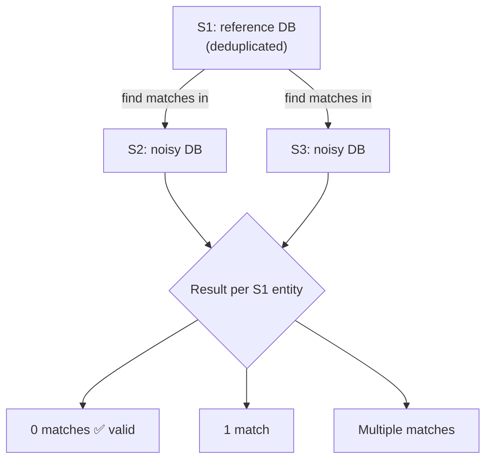
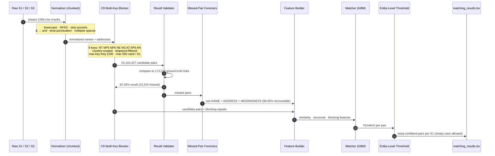
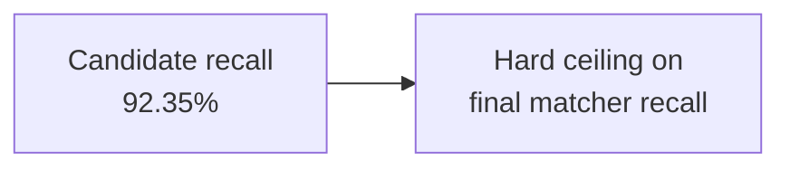
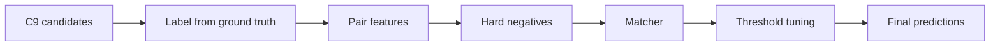
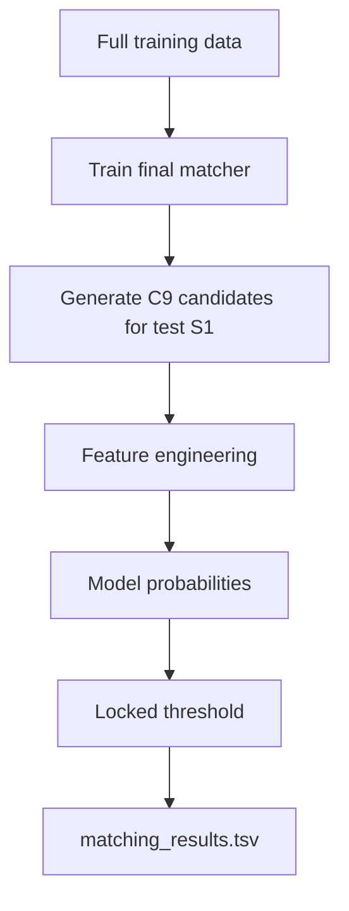

<div align="center">

# 🏆 Amazon ML Challenge 2026
### Noisy Business Entity Resolution Pipeline

**Normalize → Block (C9) → Validate → Featurize → Match**


| 🎯 Blocking recall | 🔗 True links recovered | 🧮 S1 entities evaluated | 🧪 Blocking strategies tested |
|:---:|:---:|:---:|:---:|
| **92.35%** | **159,970 / 173,213** | **49,996** | **8** |

</div>

> **Read this first:** 92.35% is **blocking recall** (the ceiling on what any matcher can reach) on the validated 49,996-entity S1 sample. It is **not** the final competition score.

---

## 📑 Contents

1. [TL;DR](#-tldr)
2. [Who Did What (with proof)](#-who-did-what)
3. [The Problem](#-the-problem)
4. [Pipeline Interaction Diagram](#-pipeline-interaction-diagram)
5. [Architecture](#-architecture)
6. [Normalization](#-normalization)
7. [The 8-Experiment Journey to C9](#-the-8-experiment-journey-to-c9)
8. [C9 Blocking Strategy](#-c9-blocking-strategy)
9. [Validation Results](#-c9-validation-results)
10. [Missed-Pair Forensics](#-missed-pair-forensics)
11. [Matching Stage](#-matching-stage)
12. [Project Status](#-project-status)
13. [Repository Structure](#-repository-structure)
14. [Reproduce the Evidence](#-reproduce-the-evidence)
15. [Credits and License](#-credits-and-license)

---

## ⚡ TL;DR

- The task: for every business in a clean reference database (**S1**), find its matches in two noisy databases (**S2**, **S3**). There can be **0, 1, or many** matches, so one-to-one matching can't be assumed.
- The hard part was **not the classifier**. It was shrinking millions of possible pairs to a candidate set that still contains the true matches, without running out of memory.
- Seven blocking designs failed (24% recall, memory blow-ups, candidate explosions). The eighth, **C9 multi-key blocking**, reached **92.35% recall** on 24.1M candidate pairs.
- A forensic pass over the 13,243 missed links showed **~98.65% of them still had recoverable name or address evidence**, which directly shaped the matching-feature design.

---

## 🧾 Who Did What

**Dharmi Sapariya** designed and built the solution: dataset exploration, the normalization approach, all eight blocking experiments, the C9 blocker, recall validation, missed-pair forensics, the matching-stage design, and the diagrams and documentation.

**Jasmine** ran the feature-generation step on the candidate pairs and supported the matching stage by running the model-training and threshold-tuning experiments.

| Area | Owner | Evidence in this repo |
|---|---|---|
| Dataset exploration (schema, missingness, country mix, candidate-explosion risk) | **Dharmi** | [Notebooks](./notebooks) · [Status table](#-project-status) |
| Memory-aware normalization (chunked loading, NFKD, accent removal, `&`→`and`) | **Dharmi** | [Normalization](#-normalization) |
| Blocking experiments E1 to E8 (7 rejected, 1 adopted) | **Dharmi** | [Experiment log](#-experiment-log) |
| C9 blocker design and configuration | **Dharmi** | [C9 Blocking Strategy](#-c9-blocking-strategy) |
| Recall validation (49,996 entities, 24.1M pairs) | **Dharmi** | [Validation results](#-c9-validation-results) |
| Missed-pair forensics (13,243 links, 9,606 entities) | **Dharmi** | [Forensics](#-missed-pair-forensics) |
| Matching-stage design (feature plan, hard negatives, entity-level F0.5, thresholds) | **Dharmi** | [Matching Stage](#-matching-stage) |
| Diagrams, README, error-analysis write-up | **Dharmi** | This file |
| Running feature generation on candidate pairs | Jasmine | n/a |
| Running model-training and threshold-tuning experiments | Jasmine | n/a |

### 🔍 Verify it yourself

Don't take a README's word for it. Authorship is in the git history:

```bash
git clone https://github.com/DharmiSapariya/Amazom_ML_Challenge_2026.git
cd Amazom_ML_Challenge_2026

git shortlog -sn --all                 # commits per author
git log --stat --author="Dharmi"       # what each commit touched
git log --follow -p -- notebooks/      # full history of every notebook
```

Or browse the [commit history](https://github.com/DharmiSapariya/Amazom_ML_Challenge_2026/commits/main/) and the [Insights → Contributors graph](https://github.com/DharmiSapariya/Amazom_ML_Challenge_2026/graphs/contributors) on GitHub.

<!-- Optional: add screenshots of `git shortlog -sn` and the Kaggle notebook version history under docs/proof/ and embed them here, e.g.
 -->

---

## 🎯 The Problem



The same business can show up as:

- `Primary Care Specialists Inc` / `Primary Care Specialists Incorporated` / `primary care stpianlsts inc`
- `Straight Edge Hypnosis` / `Straight Edge Hpyosris`

Addresses add abbreviations, missing or reordered parts, transliteration, landmarks and numbering differences on top.

| Approach | Works? |
|---|:---:|
| Exact match | ❌ |
| Normalization only | ❌ |
| One giant fuzzy search | ❌ (millions × millions) |
| **Two-stage resolution: high-recall blocking → precision-aware matching** | ✅ |

---

## 🔄 Pipeline Interaction Diagram

How every component talks to the next, and what each hands over:



---

## 🏗️ Architecture

```mermaid
flowchart LR
    A["Raw S1 / S2 / S3"] --> B["Chunked loading"]
    B --> C["Normalization"]
    C --> D["C9 multi-key blocking"]
    D --> E["Candidate ranking<br/>(# shared keys)"]
    E --> F["Candidate pairs"]
    F --> G["Similarity features"]
    G --> H["Hard-negative mining"]
    H --> I["Matching model"]
    I --> J["P(match)"]
    J --> K["Entity-level threshold"]
    K --> L["Final results"]

    classDef done fill:#d4edda,stroke:#28a745,color:#000;
    classDef todo fill:#fff3cd,stroke:#ffc107,color:#000;
    class A,B,C,D,E,F done;
    class G,H,I,J,K,L todo;
```



> 🟩 complete · 🟨 in progress

| Stage | Goal |
|---|---|
| **A: Retrieval / Blocking** | Find a high-recall set of *plausible* candidates |
| **B: Matching** | Decide which candidates are *actually* the same entity |

**Why recall first?** A matcher can never recover a true pair that blocking never handed it:



---

## 🧹 Normalization

Memory-aware, applied in `chunksize=100000` chunks so the full S2/S3 databases never need to sit in RAM:

1. Lowercase
2. Unicode **NFKD** normalization
3. Accent removal
4. `&` → `and`
5. Punctuation removal
6. Non-alphanumeric cleanup
7. Whitespace collapse

Both **normalized names and normalized addresses** are retained, because the forensics later showed that either one can be the deciding signal.

---

## 🧪 The 8-Experiment Journey to C9

Seven approaches failed before the one that worked. The failures are kept on purpose, since they are the reason the final architecture looks the way it does.

### 📋 Experiment Log

| # | Strategy | What happened | Verdict |
|:-:|---|---|:-:|
| E1 | Name prefix (4 chars) + address last token | **~24% recall**; far too brittle for reordered names, typos and legal suffixes | ❌ |
| E2 | Broad multi-key (tokens, prefixes, Soundex, address combos) | **~4,615 candidates per S1**, so the downstream search space was unusable | ❌ |
| E3 | Phonetic (Soundex-style) indexing | Index expansion caused a **memory explosion** | ❌ |
| E4 | Brute-force character TF-IDF | Good representation, but nearest-neighbour over millions of rows was **too expensive** | ❌ |
| E5 | Chunked TF-IDF | Memory improved, compute still **too expensive** | ❌ |
| E6 | Generated character signatures (phonetic + deletions + shapes) | Huge Python index, **memory explosion** | ❌ |
| E7 | Coarse blocker (country + first/last char + length bucket) | **0 additional true pairs** recovered | ❌ |
| **E8 / C9** | **Multi-key blocking ranked by shared-signal count** | **92.35% validated recall** | ✅ |

```
Recall by experiment (higher is better, E2–E7 failed on cost / memory, not on a recall figure)

E1  ██████░░░░░░░░░░░░░░░░░░░░  ~24%
E8  ███████████████████████░░░  92.35%   ← C9, shipped
```

---

## 🔑 C9 Blocking Strategy

**Principle:** don't depend on one fragile key. Use several independent keys and rank candidates by *how many signals agree*.

| Name keys | Meaning | | Address keys | Meaning |
|---|---|---|---|---|
| `NT` | Distinctive exact token | | `AT` | Exact address token |
| `NP5` | 5-char token prefix | | `AP6` | 6-char address prefix |
| `NP6` | 6-char token prefix | | `AN` | Number + address token |
| `NE` | Whole normalized name | | | |
| `NS` | Sorted normalized name tokens | | | |

**Extra controls**

- **Country-aware keys:** keys are scoped as `(country, key)`, which cuts cross-country collisions while keeping open-set behaviour.
- **Generic-token filtering:** terms such as `the, and, for, inc, llc, ltd, limited, company, corp, corporation, co, group, services, solutions, international, india, usa, us` can't become dominant keys, so `"company"` never creates a giant bucket.
- **Frequency and size caps:**

```python
MAX_KEY_FREQUENCY     = 1200
MAX_CANDIDATES_PER_S1 = 500
MIN_TOKEN_LEN         = 3
```

**Ranking:** candidates are ordered by the **number of independent keys shared**, so more agreeing signals means a stronger candidate. The top 500 are kept.

---

## 📈 C9 Validation Results

Validated against the real ground-truth links for the exact S1 entities evaluated:

| Metric | Value |
|---|---:|
| S1 entities evaluated | 49,996 |
| Candidate pairs generated | 24,104,327 |
| Ground-truth true links | 173,213 |
| True links recovered | 159,970 |
| True links missed | 13,243 |
| **Blocking recall** | **92.35%** |

```
Recall = 159,970 / 173,213 = 92.35%
```

Average candidate load is roughly 482 pairs per S1, down from E2's ~4,615, a **~9.6× reduction** in the downstream search space while recall went from ~24% (E1) to 92.35%.

---

## 🔬 Missed-Pair Forensics

Rather than guessing why 13,243 links were missed, they were extracted (**9,606 unique S1 entities**) and scored with RapidFuzz:

| Similarity condition | Missed pairs | Share of missed |
|---|---:|---:|
| Name WRatio ≥ 70 | 9,799 | n/a |
| Address WRatio ≥ 70 | 9,809 | n/a |
| **Either field ≥ 70** | **13,064** | **≈ 98.65%** |
| **Either field ≥ 80** | **12,477** | **≈ 94.21%** |

> 🧠 **Key finding:** the missed matches were *not* hopeless. Almost all had recoverable evidence in the name **or** the address. Patterns included *strong name + weak address* and *weak/missing name + strong address*.
>
> **Design consequence:** the matcher must treat **name + address + missingness + structure** as complementary evidence, never name similarity alone.

---

## 🤝 Matching Stage

The candidate generator is done. The matcher builds on its output; **don't restart candidate generation** unless validation shows a specific recall problem.



### Design decisions

| Decision | Why |
|---|---|
| **Split by S1 entity**, never by candidate row | Row-level splitting leaks candidates from the same S1 across train and validation |
| **Hard negatives** (e.g. name sim 95%, address sim 90%, `match=0`) | Random negatives at 4% similarity teach nothing; near-duplicates teach "very similar ≠ same entity" |
| **Keep blocking signals as features** (shared-key count, which keys fired, rank, score) | Tells the model *why* a pair became a candidate, not just how similar it is |
| **No default 0.5 threshold** | The metric is precision-heavy; sweep `0.50 … 0.95` and evaluate **per S1 entity** (F0.5 behaviour) |
| **Empty rows are valid** | A weak guess can score worse than correctly predicting no match |
| **No forced one-to-one** | Each S1 can map to 0, 1 or many S2/S3 entities |

### Feature groups

| Group | Features |
|---|---|
| **Name** | WRatio · Ratio · Token Sort · Token Set · Levenshtein · Jaccard · exact match · token overlap · length difference |
| **Address** | The name set, plus number overlap and postcode overlap |
| **Structural** | Country match · name/address missing flags · lengths · shared token and numeric-token counts |
| **Blocking** | # shared keys · which keys fired · candidate rank · candidate score |

**Model:** LightGBM or XGBoost, with `HistGradientBoostingClassifier` as fallback → outputs `P(match)`.

### Final inference path



### Output format

An empty S1 row is a valid, intentional output:

```
S1-A    S2-123
S1-B
S1-C    S3-456
S1-D    S2-111,S3-222
```

### Submission safety checks

```python
assert output_s1_count == test_s1_count
assert duplicate_s1_count == 0
assert invalid_entity_ids == 0
assert predictions_outside_candidate_set == 0
```

---

## 🧭 Project Status

| Stage | Status |
|---|:---:|
| Dataset exploration | ✅ Complete |
| Normalization | ✅ Complete |
| Memory-aware preprocessing | ✅ Complete |
| Blocking experiments (E1 to E8) | ✅ Complete |
| Candidate generation (C9) | ✅ Complete |
| Candidate recall validation | ✅ Complete |
| Missed-pair investigation | ✅ Complete |
| Matching features | 🔄 In progress |
| Hard-negative training | 🔄 In progress |
| Matcher | 🔄 In progress |
| Threshold optimization | 🔄 In progress |
| Full test inference | ⏳ Pending |
| Final submission | ⏳ Pending |

---

## 📁 Repository Structure

```
Amazom_ML_Challenge_2026/
├── README.md
├── notebooks/            # candidate generation, validation, matching work
├── code/                 # planned: normalize.py, build_candidates.py,
│                         #   validate_candidates.py, build_features.py,
│                         #   train_matcher.py, generate_submission.py
├── reports/              # planned: candidate_recall.md, error_analysis.md, experiment_log.md
├── output/               # planned: candidate_pairs.tsv, matching_results.tsv
└── requirements.txt      # planned
```

> The raw datasets are **not** committed. Dataset: provided by Dharmi Sapariya (shared privately on Kaggle).

---

## 🧪 Reproduce the Evidence

Every headline number above can be re-derived from the candidate pairs and the ground-truth file:

```python
# 1. Recall
recovered = candidates.merge(truth, on=["s1_id", "match_id"]).shape[0]
recall = recovered / len(truth)            # 159,970 / 173,213 = 0.9235

# 2. Missed-pair similarity (forensics)
from rapidfuzz import fuzz
missed["name_wr"] = [fuzz.WRatio(a, b) for a, b in zip(missed.s1_name, missed.m_name)]
missed["addr_wr"] = [fuzz.WRatio(a, b) for a, b in zip(missed.s1_addr, missed.m_addr)]
(missed[["name_wr", "addr_wr"]].max(axis=1) >= 70).mean()   # ≈ 0.9865
```

---

## 🙌 Credits and License

- **Dharmi Sapariya**: solution design, dataset exploration, normalization, blocking experiments and C9, recall validation, missed-pair forensics, matching-stage design, diagrams and documentation.
- **Jasmine**: ran the feature-generation step on the candidate pairs and supported the matching stage with model-training and threshold-tuning runs.

Built for the Amazon ML Challenge 2026. This project is not affiliated with Amazon. Code released under the **MIT License**.
