<div align="center">

# 🏆 Amazon ML Challenge 2026
### Noisy Business Entity Resolution Pipeline

**Clean → Shortlist → Verify → Match**


| 🎯 Blocking recall | 🔗 True links found | 🧮 Entities validated | 🧪 Strategies tried |
|:---:|:---:|:---:|:---:|
| **92.35%** | **159,970 / 173,213** | **49,996** | **8** |

</div>

> **Note:** 92.35% is **blocking recall** (the ceiling on what any matcher can reach) on the validated 49,996-entity sample. It is **not** the final competition score.

---

## ⚡ The Whole Project in 30 Seconds

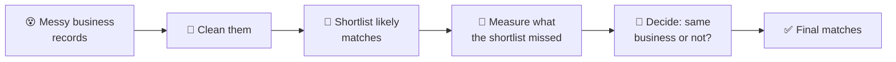

| Step | In plain words |
|---|---|
| 🧹 Clean | Make names and addresses comparable (case, accents, punctuation) |
| 🔎 Shortlist | Don't compare everything with everything. Pull a small list of *possible* matches per business |
| 📏 Measure | Check the shortlist against the answer key to see how many real matches survive |
| 🤖 Decide | For each shortlisted pair, a model says how likely it is the same business |
| ✅ Output | Keep only confident pairs. Leaving a business with *no* match is allowed |

---

## 🎯 The Problem

There is one clean reference database (**S1**) and two noisy ones (**S2**, **S3**). For every business in S1, find its matches in S2 and S3.

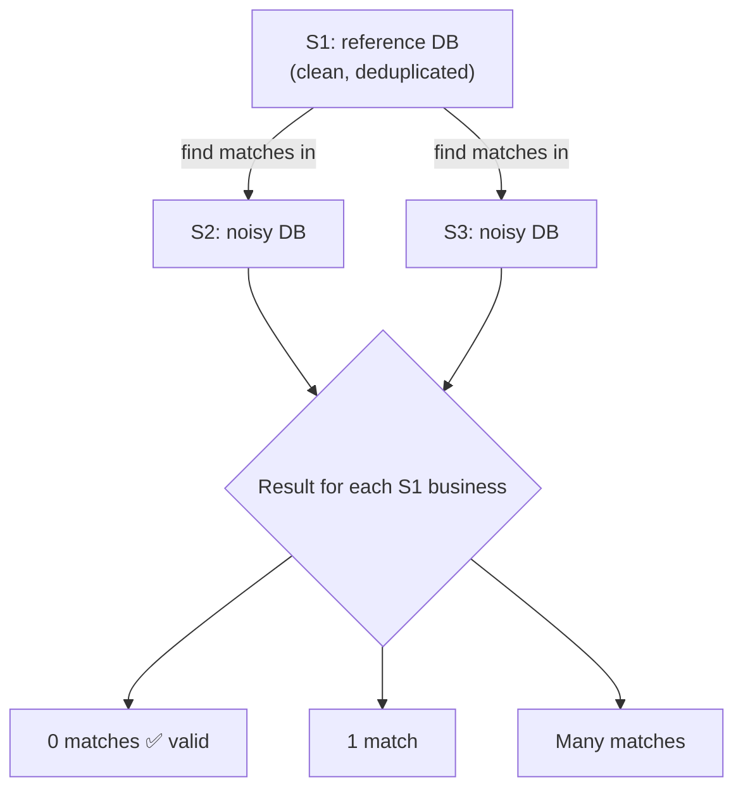

⚠️ Matching is **not** one-to-one.

**Why it's hard.** The same business shows up in many disguises:

| Clean (S1) | Noisy (S2 / S3) | What changed |
|---|---|---|
| Primary Care Specialists Inc | Primary Care Specialists Incorporated | Legal suffix |
| Primary Care Specialists Inc | primary care stpianlsts inc | Typo + case |
| Straight Edge Hypnosis | Straight Edge Hpyosris | Typos |

Addresses add abbreviations, missing or reordered parts, transliteration and landmarks on top.

| Approach | Works? |
|---|:---:|
| Exact match | ❌ |
| Normalization alone | ❌ |
| One giant fuzzy search over everything | ❌ (millions × millions) |
| **Two stages: shortlist first, then verify** | ✅ |

---

## 🏗️ Architecture


🟩 **Stage A: Retrieval / Blocking** (find plausible candidates, maximize recall)
🟦 **Stage B: Matching** (decide which candidates are truly the same business, maximize precision)

**Why two stages?** The matcher can only judge pairs it is given, so blocking recall is a hard ceiling:

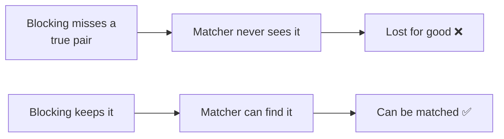

---

## 🔄 Pipeline Interaction Diagram

Every component, what it receives and what it hands over:


---

## 📉 The Funnel: From Millions of Comparisons to a Usable Shortlist

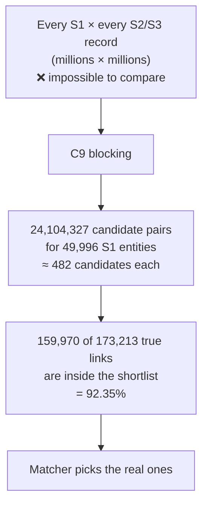

Compared with the broad multi-key attempt (E2, about 4,615 candidates per entity), C9's shortlist is roughly **9.6× smaller** while recall rose from about 24% (E1) to **92.35%**.

---

## 🧹 Normalization

Memory-aware, done in `chunksize=100000` chunks so the full databases never sit in RAM.

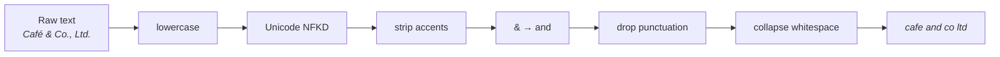

Both the **normalized name and normalized address** are kept, because either can be the deciding signal.

---

## 🧪 The 8-Experiment Journey to C9

Seven designs failed before one worked. The failures are kept on purpose: they explain why the final design looks the way it does.

```mermaid
flowchart LR
    E1["E1<br/>Prefix + address tail"] -->|"~24% recall"| E2["E2<br/>Broad multi-key"]
    E2 -->|"~4,615 cand/S1"| E3["E3<br/>Phonetic index"]
    E3 -->|"memory blow-up"| E4["E4<br/>Brute TF-IDF"]
    E4 -->|"too slow"| E5["E5<br/>Chunked TF-IDF"]
    E5 -->|"still slow"| E6["E6<br/>Char signatures"]
    E6 -->|"memory blow-up"| E7["E7<br/>Coarse blocker"]
    E7 -->|"0 new pairs"| E8["E8 = C9<br/>Multi-key + ranking"]
    E8 -->|"92.35% recall"| W["🏆 Adopted"]

    classDef bad fill:#f8d7da,stroke:#dc3545,color:#000;
    classDef good fill:#d4edda,stroke:#28a745,color:#000;
    class E1,E2,E3,E4,E5,E6,E7 bad;
    class E8,W good;
```

### 📋 Experiment Log

| # | Strategy | What happened | Verdict |
|:-:|---|---|:-:|
| E1 | Name prefix (4 chars) + address last token | **~24% recall**; too brittle for reordered names, typos, legal suffixes | ❌ |
| E2 | Broad multi-key (tokens, prefixes, Soundex, address combos) | **~4,615 candidates per S1**; search space unusable | ❌ |
| E3 | Phonetic (Soundex-style) indexing | Index expansion caused a **memory explosion** | ❌ |
| E4 | Brute-force character TF-IDF | Good representation, but nearest-neighbour over millions of rows was **too expensive** | ❌ |
| E5 | Chunked TF-IDF | Memory improved, compute **still too expensive** | ❌ |
| E6 | Generated character signatures | Huge Python index, **memory explosion** | ❌ |
| E7 | Coarse blocker (country + first/last char + length bucket) | **0 additional true pairs** | ❌ |
| **E8 / C9** | **Multi-key blocking ranked by shared-signal count** | **92.35% validated recall** | ✅ |

---

## 🔑 C9 Blocking Strategy

**Principle:** never depend on one fragile key. Use several independent keys and trust a pair more when **more keys agree**.

| Name keys | Meaning | | Address keys | Meaning |
|---|---|---|---|---|
| `NT` | Distinctive exact token | | `AT` | Exact address token |
| `NP5` | 5-char token prefix | | `AP6` | 6-char address prefix |
| `NP6` | 6-char token prefix | | `AN` | Number + address token |
| `NE` | Whole normalized name | | | |
| `NS` | Sorted normalized name tokens | | | |

### How a candidate gets chosen (illustrative example)

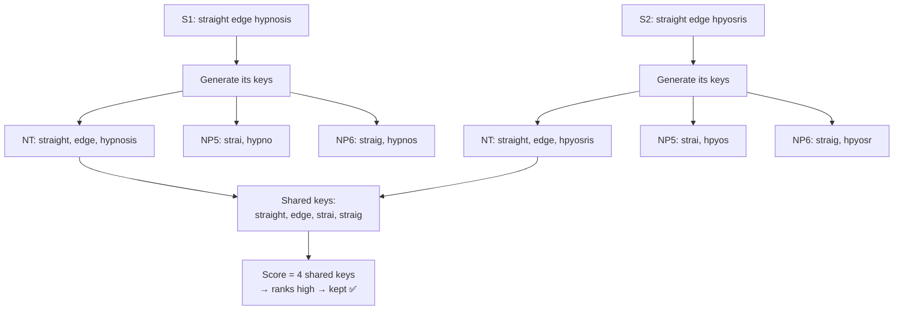

Despite the typos in the third word, the pair still survives because other keys agree.

### Safeguards

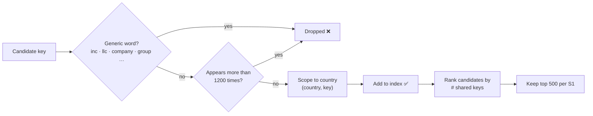

```python
MAX_KEY_FREQUENCY     = 1200
MAX_CANDIDATES_PER_S1 = 500
MIN_TOKEN_LEN         = 3
```

---

## 📈 C9 Validation Results

Checked against the real ground-truth links for the exact S1 entities evaluated:

| Metric | Value |
|---|---:|
| S1 entities evaluated | 49,996 |
| Candidate pairs generated | 24,104,327 |
| Ground-truth true links | 173,213 |
| True links recovered | 159,970 |
| True links missed | 13,243 |
| **Blocking recall** | **92.35%** |

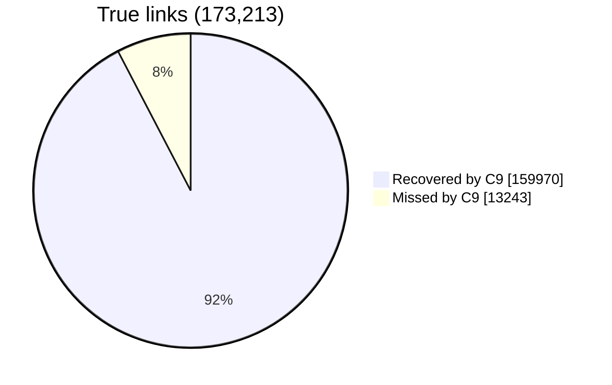

```
Recall = 159,970 / 173,213 = 92.35%
```

---

## 🔬 Missed-Pair Forensics

The 13,243 missed links (**9,606 unique S1 entities**) were pulled out and scored with RapidFuzz instead of guessed at.

| Similarity condition | Missed pairs | Share of missed |
|---|---:|---:|
| Name WRatio ≥ 70 | 9,799 | n/a |
| Address WRatio ≥ 70 | 9,809 | n/a |
| **Either field ≥ 70** | **13,064** | **≈ 98.65%** |
| **Either field ≥ 80** | **12,477** | **≈ 94.21%** |

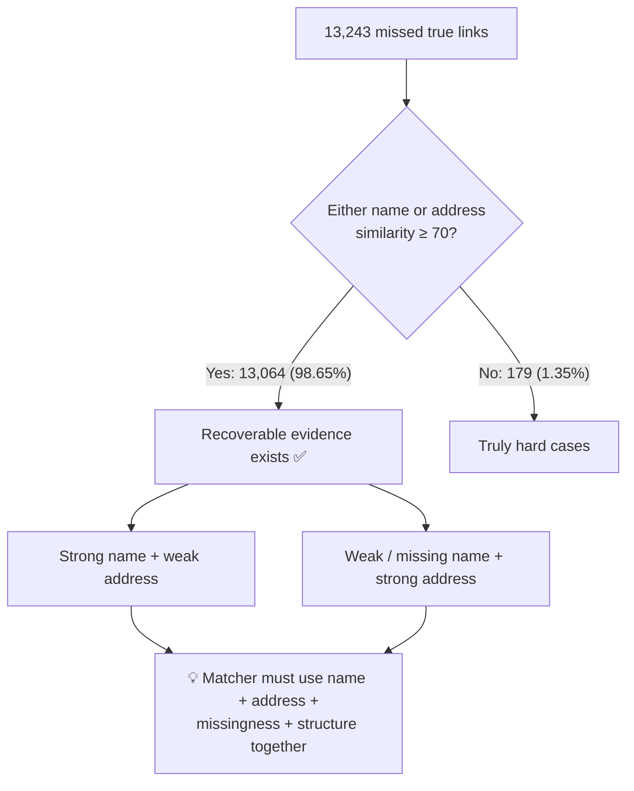

> 🧠 **Key finding:** the misses were not hopeless. Nearly all had usable evidence in the name **or** the address, so the matcher never relies on name similarity alone.

---

## 🤖 Matching Stage

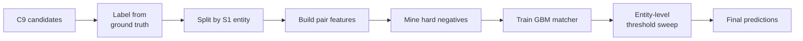

### Feature groups

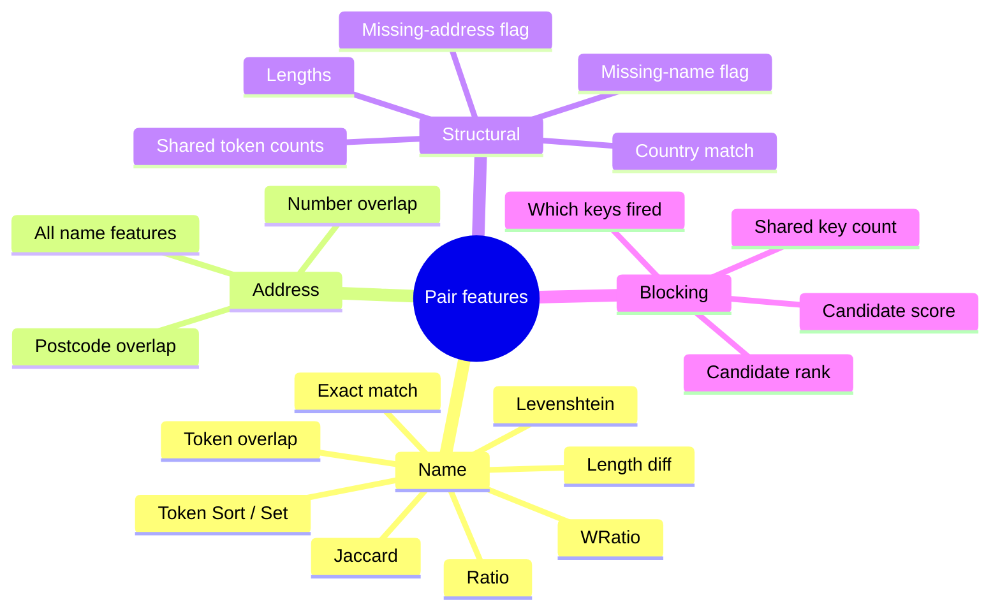

### Key design decisions

| Decision | Why |
|---|---|
| **Split by S1 entity**, never by row | Row-level splits leak candidates of the same S1 into both train and validation |
| **Hard negatives** (name sim 95%, address sim 90%, not a match) | Random negatives at 4% similarity teach nothing; near-duplicates teach "very similar ≠ same entity" |
| **Keep blocking signals as features** | Tells the model *why* a pair became a candidate, not just how similar it looks |
| **No default 0.5 threshold** | The metric is precision-heavy; sweep `0.50 … 0.95` and score per S1 entity (F0.5) |
| **Empty rows are valid** | A weak guess can score worse than correctly predicting no match |
| **No forced one-to-one** | Each S1 can match 0, 1 or many S2/S3 entities |

**Model:** LightGBM / XGBoost (fallback `HistGradientBoostingClassifier`) → outputs `P(match)`.

### Decision flow for each candidate pair

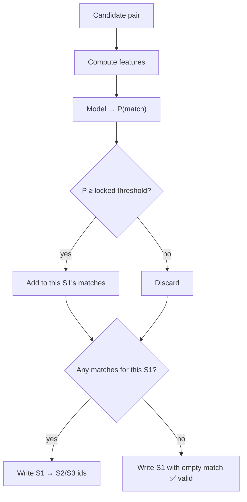

### Output format

```
S1-A    S2-123
S1-B
S1-C    S3-456
S1-D    S2-111,S3-222
```

### Final inference path

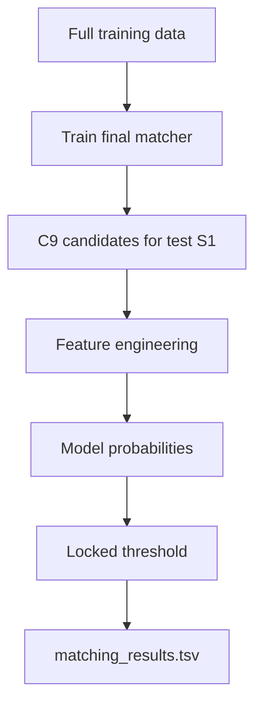

### Submission safety checks

```python
assert output_s1_count == test_s1_count
assert duplicate_s1_count == 0
assert invalid_entity_ids == 0
assert predictions_outside_candidate_set == 0
```

---

## ✅ Project Status: Complete

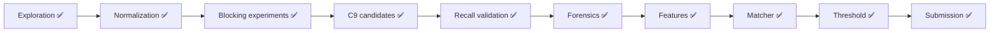

| Stage | Status |
|---|:---:|
| Dataset exploration | ✅ |
| Normalization | ✅ |
| Blocking experiments (E1 to E8) | ✅ |
| Candidate generation (C9) | ✅ |
| Candidate recall validation | ✅ |
| Missed-pair investigation | ✅ |
| Feature generation | ✅ |
| Matcher training | ✅ |
| Threshold optimization | ✅ |
| Test inference and submission | ✅ |

---

## 🧠 The One Idea to Remember

> **Don't make the blocker solve matching.**
>
> - The **blocker** asks: *"Could these two records plausibly be the same business?"*
> - The **matcher** asks: *"Given that they're plausible, are they actually the same business?"*

That split keeps the system **scalable, measurable, debuggable and model-friendly**.

---

## 🧪 Reproduce the Numbers

```python
# Recall
recovered = candidates.merge(truth, on=["s1_id", "match_id"]).shape[0]
recall = recovered / len(truth)            # 159,970 / 173,213 = 0.9235

# Missed-pair similarity (forensics)
from rapidfuzz import fuzz
missed["name_wr"] = [fuzz.WRatio(a, b) for a, b in zip(missed.s1_name, missed.m_name)]
missed["addr_wr"] = [fuzz.WRatio(a, b) for a, b in zip(missed.s1_addr, missed.m_addr)]
(missed[["name_wr", "addr_wr"]].max(axis=1) >= 70).mean()   # ≈ 0.9865
```

---

## 📁 Repository

```
Amazom_ML_Challenge_2026/
├── README.md
└── notebooks/        # exploration, candidate generation, validation, matching
```

The raw dataset is **not** included in this repository.

---

## 🙌 Credits

**Dharmi Sapariya** designed and built the solution: dataset exploration, the normalization approach, all eight blocking experiments, the C9 blocker, recall validation, missed-pair forensics, the matching-stage design, and the diagrams and documentation. The dataset was provided by Dharmi Sapariya (shared privately on Kaggle).

**Jasmine** ran the feature-generation step on the candidate pairs and supported the matching stage with model-training and threshold-tuning runs.

**Verify authorship** in the git history:

```bash
git shortlog -sn --all                 # commits per author
git log --stat --author="Dharmi"       # what each commit touched
git log --follow -p -- notebooks/      # full history of every notebook
```

Or see the [commit history](https://github.com/DharmiSapariya/Amazom_ML_Challenge_2026/commits/main/) and [contributors graph](https://github.com/DharmiSapariya/Amazom_ML_Challenge_2026/graphs/contributors).

<!-- Optional: add proof screenshots under docs/proof/ and embed them here:
 -->

---

Built for the Amazon ML Challenge 2026. This project is not affiliated with Amazon. Code released under the **MIT License**.
